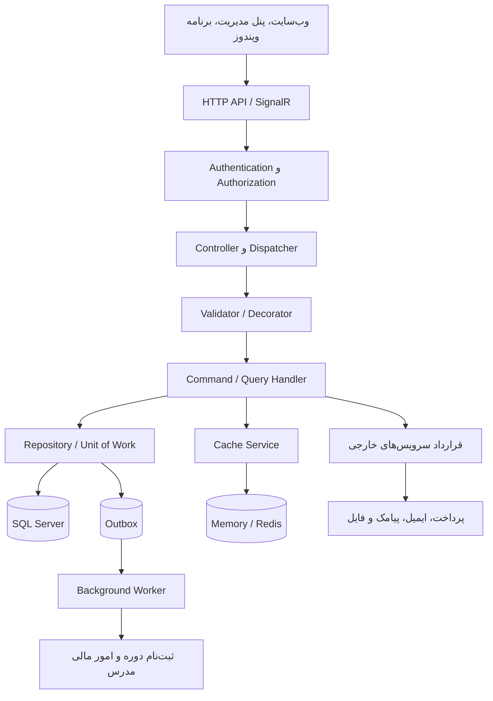

# تحلیل مرحله اول بک‌اند ArkaLearn-Pro

تاریخ بررسی: ۲۰۲۶/۱۰/۲۵ — دامنه بررسی: `BackEnd/ArkaSoftware` و `BackEnd/Framework`.

این گزارش بر پایه فهرست‌برداری پروژه‌ها، بررسی وابستگی‌ها، مطالعه لایه‌های پایه و مسیرهای منتخب احراز هویت، پیام‌ها، سبد خرید، پرداخت و تحویل دوره، تنظیمات، ساخت پروژه و اجرای تست‌های محلی تهیه شده است. تمام متدهای همه فایل‌ها به‌صورت خط‌به‌خط ممیزی نشده‌اند. یافته‌های کدی از مواردی که به تأیید در محیط آزمایشی نیاز دارند جدا شده‌اند. در این مرحله کد محصول، تنظیمات و Migrationها تغییر نکرده‌اند؛ فقط خروجی تحلیل و لاگ‌های بررسی به پوشه docs اضافه شده‌اند. اجرای build خروجی‌های معمول bin/obj را تولید کرده است.

## ۱. ساختار واقعی

| بخش | وضعیت مشاهده‌شده |
|---|---|
| Solution اصلی | `BackEnd/ArkaSoftware/ArkaSoftware.sln` |
| Solution زیرساخت مشترک | `BackEnd/Framework/Framework.sln` |
| پروژه‌ها | ۲۲ فایل csproj، شامل دو پروژه تست |
| کد C# | ۲۴۶۱ فایل با حذف bin/obj؛ ۲۳۳۹ فایل با حذف پوشه‌های Migrations |
| API | ۶۳ فایل Controller و ۸ فایل Hub |
| Migrationهای اصلی | ۱۱۳ فایل Migration با حذف Designer و Snapshot |
| Target Framework محصول | `net9.0` |
| Target Framework زیرساخت مشترک | `net8.0` |
| Target Framework تست‌ها | `net10.0` |
| SDK استفاده‌شده در بررسی | `10.0.302` |

ساختار فعلی یک برنامه یکپارچه چندلایه با تفکیک Command/Query و الگوهای DDD است. مرز قابلیت‌ها عمدتاً با پوشه‌ها، Aggregateها، قراردادها و Handlerها مشخص شده است. جداسازی Command و Query در کد و DbContext وجود دارد؛ ثبت هر دو DbContext از یک فراهم‌کننده Connection String استفاده می‌کند. جداسازی فیزیکی پایگاه داده خواندن و نوشتن در پیکربندی بررسی‌شده دیده نشد.

| لایه | مسئولیت و مشاهدات |
|---|---|
| Domain | Aggregate، Entity، Value Object، قواعد دامنه و Domain Event |
| RequestResponse | Command، Query، DTO، Validator و بخشی از اطلاعات مسیر HTTP |
| Contracts | قرارداد Repository، Unit of Work و سرویس‌ها؛ وابسته به Domain و RequestResponse |
| ApplicationService | اجرای Use Caseها با Command/Query/Event Handler و سرویس‌های دامنه کاربردی |
| Infrastructure/MSSQL | نگاشت EF Core، Repository، تراکنش، Migration و مدل‌های خواندن |
| Infrastructure/Redis | Repositoryهای کش؛ در کنار سرویس کش جدید در API |
| Infrastructure/Security | JWT، Google Auth و تطبیق مدل‌های کاربر |
| Endpoints/API | Controller، Hub، Middleware، ثبت DI و تعداد زیادی پیاده‌سازی زیرساختی |
| Framework | Dispatcher، Decorator، BaseController، Repository/DbContext پایه، Audit، Outbox و کلاینت درگاه‌ها |

مسیر معمول درخواست:

## ۲. قابلیت‌های موجود در مدل و کد

| حوزه | اجزای مشاهده‌شده |
|---|---|
| حساب و امنیت | User، Student، Teacher، JWT/Cookie، Google Login، OTP، ورود دومرحله‌ای، بازیابی رمز و محدودیت حساب/IP |
| آموزش | Course، Lesson، پیشرفت تماشا، Enrollment، EducationPlan، اقساط، Exam و QuestionBank |
| کلاس و ارتباط زنده | Room، RoomSession، مدیریت صندلی، MeetingHub، Chat و تنظیمات انتقال رسانه زنده |
| تجارت و مالی | Basket، Order، Invoice، Transaction، کیف پول کاربر/مدرس، سهم فروش و درخواست تسویه |
| محتوا | Article، Project، Software، Category، Tag، دیدگاه و علاقه‌مندی |
| کتاب | مدل TeacherBook و عملیات کتاب در حوزه Teacher؛ مرز کتاب فعلاً با پروفایل/محتوای مدرس گره خورده است |
| پشتیبانی | SupportChat، SupportTicket، اشتراک پشتیبانی، CommunityDiscussion، ProjectQuestion و RemoteAssist |
| دسکتاپ و رسانه | DesktopDrm، Device/Session، مجوز پخش آفلاین، کلید محتوا، DesktopAppRelease و MediaAsset |
| عملیات | ایمیل و قالب‌ها، پیامک، Newsletter، Notification، تقویم، فایل/FTP، Watermark و UserActivity |

وجود این اجزا به معنی تأیید کامل بودن رفتار آن‌ها نیست. به‌ویژه اگر کتاب و نرم‌افزار باید مانند دوره، کالای مستقل با قیمت، سفارش، فاکتور و حق دسترسی باشند، باید مسیر خرید و تحویل هرکدام جداگانه با نیاز محصول تطبیق داده شود.

## ۳. نقاط قابل اتکا برای ادامه توسعه

- تفکیک لایه‌ها و قرارداد Repositoryها پایه مناسبی برای اصلاح تدریجی فراهم می‌کند.
- قواعد مهمی مانند وضعیت دوره و ثبت‌نام در مدل دامنه و سرویس‌های مرتبط قرار گرفته‌اند.
- برای InvoicePaid، Outbox و سرویس تحویل خرید وجود دارد؛ مسیر جبران برخی آثار پرداخت نیز پیش‌بینی شده است.
- کش منطقه‌ای با Attribute و ابطال پس از Command پیاده‌سازی شده است.
- JWT، Cookie، OTP، فایل امضاشده و DRM به‌صورت اجزای مشخص قابل شناسایی‌اند.
- تست‌های موجود اتاق، Hub، حضور زنده و ایمیل، نقطه شروع مناسبی برای گسترش تست‌ها هستند.

## ۴. نتیجه ساخت و تست

| بررسی | نتیجه |
|---|---|
| `dotnet build BackEnd/ArkaSoftware/ArkaSoftware.sln --no-restore --nologo -v quiet` | موفق؛ ۰ خطا و ۲۳۸۵ هشدار |
| `dotnet build BackEnd/Framework/Framework.sln --no-restore --nologo -v quiet` | موفق؛ ۰ خطا و ۱۱ هشدار |
| تست محلی با حذف PleskSmtpLiveTests | ۲۵ تست انتخاب‌شده؛ ۲۴ موفق و ۱ ناموفق |
| پروژه Integration | فقط Class1 خالی؛ فاقد تست اجرایی در کد بررسی‌شده |

بخشی از هشدارهای ساخت اصلی مربوط به XML Documentation و nullable است؛ هشدارهای پکیج آسیب‌پذیر، PackageReference تکراری و پنهان شدن اعضای ارث‌بری نیز وجود دارد. عدد هشدارها تعداد نقص مستقل محصول نیست.

تست ناموفق:

`EmailServiceRegistrationTests.RegisterEmailService_uses_smtp_when_fully_configured`

علت مشاهده‌شده: `IEmailTemplateProvider` در ServiceCollection خود تست ثبت نشده است. Factory سرویس ایمیل به آن نیاز دارد. این وابستگی در HostingExtension اصلی ثبت شده است؛ بنابراین این شکست به‌تنهایی اثبات خرابی راه‌اندازی ایمیل در محیط واقعی نیست. پس از رفع وابستگی نخست، کامل بودن سایر وابستگی‌های تست نیز باید بررسی شود.

دو تست PleskSmtpLiveTests به سرویس بیرونی مربوط‌اند و با فیلتر از اجرای این بررسی کنار گذاشته شدند. یک تست خالی Test1 نیز در شمار تست‌های موفق قرار دارد. Coverage اندازه‌گیری نشده است.

لاگ‌های نگهداری‌شده:

- `docs/backend-unit-test-output.log`
- `docs/backend-framework-build-output.log`

ساخت اصلی پیش از ساخت مستقل Framework انجام شد و از DLLهای موجود استفاده کرد. این بررسی، ساخت روی محیط فعلی را تأیید می‌کند؛ ساخت از یک پوشه کاملاً تازه و بدون خروجی‌های قبلی تأیید نشده است. Restore و ممیزی آنلاین تمام وابستگی‌ها نیز انجام نشده‌اند.

## ۵. یافته‌های اولویت‌دار

اولویت‌ها برای ترتیب بررسی مشترک هستند: P0 فوری، P1 بالا، P2 متوسط. شدت نهایی ریسک‌های وابسته به استقرار باید در محیط آزمایشی تعیین شود.

### B01 — P0 — اتصال ناکافی نتیجه پرداخت به سفارش ثبت‌شده سرور

**شاهد:** `PaymentController.cs:555` مقصد و کاربر را با TryParseOrderId از پارامتر Callback استخراج می‌کند. `PaymentController.cs:1293` شناسه را به‌صورت متن شامل نوع مقصد، شناسه موجودیت و کاربر می‌سازد. در `ZibalGatewayService.cs` هنگام Verify فقط trackId به درگاه ارسال می‌شود و OrderId برگشتی وارد PaymentVerifyResult نمی‌شود. کلاینت پایه زیبال OrderId برگشتی را در مدل نتیجه دارد.

**اثر محتمل:** نتیجه یک پرداخت معتبر ممکن است به مقصد یا کاربر دیگری با مبلغ سازگار نسبت داده شود. بررسی مبلغ در بخش‌هایی از Callback وجود دارد، اما اتصال تراکنش به درخواست اولیه را به‌تنهایی اثبات نمی‌کند. در مسیر بررسی‌شده، رکورد پایدار درخواست پرداخت که پیش از رفتن به درگاه ایجاد و هنگام Callback بازیابی شود دیده نشد.

**قطعیت:** نقص اتصال در کد مسیر بررسی‌شده مشخص است؛ سوءاستفاده عملی روی هیچ درگاه واقعی آزمایش نشده است.

**جهت اصلاح پیشنهادی:** ثبت PaymentAttempt/Intent پیش از انتقال به درگاه، نگهداری Provider/PaymentId/مبلغ/مالک/مقصد، بازیابی همین رکورد در Callback، تطبیق پاسخ درگاه و مصرف اتمیک و یک‌باره تراکنش. برای پرداخت تکراری، تغییر مقصد، تغییر کاربر و تغییر مبلغ تست مستقل لازم است.

### B02 — P1 — کنترل دسترسی مسیر قدیمی پیام‌ها ناکافی و دیرهنگام است

**شاهد:** `MessageController.cs:12` روی Controller و دو Action ارسال/جست‌وجو Authorize ندارد؛ BaseController و پیکربندی عمومی بررسی‌شده نیز احراز هویت پیش‌فرض را به همه Controllerها تحمیل نمی‌کنند. در `SendMessageCommandHandler.cs:46` و `:47` پیام اضافه و Commit می‌شود؛ بررسی IsAuthenticated در خط ۴۹ انجام می‌شود. QueryHandler جست‌وجو نیز مستقیماً Repository را صدا می‌زند و `RoomQueryRepository.cs:224` بر اساس RoomId داده را می‌خواند، بدون بررسی عضویت درخواست‌کننده در اتاق.

**اثر:** مسیر ارسال می‌تواند پیش از رد درخواست اثر ذخیره‌سازی ایجاد کند. مسیر جست‌وجو در کد بررسی‌شده فاقد بررسی ورود و عضویت اتاق است. سیاست دسترسی این مسیر باید با ChatHub و MeetingHub یکسان شود.

**جهت اصلاح:** احراز هویت و مجوز عضویت/مدیریت اتاق پیش از هر دسترسی به کش، داده یا ارسال SignalR؛ تصمیم درباره حذف یا نگه‌داری مسیر قدیمی.

### B03 — P1 — الگوریتم ذخیره رمز عبور نیازمند مهاجرت است

**شاهد:** `UsersAggregate/ValueOBJs/Password.cs:70` یک بار SHA-256 را روی رمز و Salt اجرا می‌کند؛ مقایسه در خط ۸۷ با StructuralEqualityComparer است. RemoteAssistSecurity نیز برای رمز مربوط به خود از SHA-256 استفاده می‌کند.

**اثر:** در صورت افشای داده‌های رمز، هزینه حدس‌زدن با الگوریتم فعلی پایین است. OWASP استفاده از الگوریتم مخصوص رمز مانند Argon2id یا PBKDF2 را توصیه می‌کند.

**جهت اصلاح:** فرمت نسخه‌دار برای هش، پشتیبانی موقت از داده قدیمی و Rehash پس از ورود موفق، انتخاب الگوریتم و پارامتر مناسب و مقایسه امن. تغییر مستقیم الگوریتم بدون مسیر مهاجرت، ورود کاربران فعلی را مختل می‌کند.

### B04 — P1 — کلید رمزنگاری ثابت به‌عنوان fallback

**شاهد:** `AesSecretProtector.cs:58` و `ContentKeyVault.cs:79` در صورت نبود کلید معتبر، کلید را از رشته ثابت داخل کد مشتق می‌کنند. این fallback به Development محدود نشده است. در فایل Production بررسی‌شده، کلید اصلی این دو بخش درج نشده است؛ وجود متغیر محیطی در سرور واقعی بررسی نشده است.

**اثر مشروط:** استقرار بدون کلید معتبر می‌تواند با کلید قابل پیش‌بینی کار کند؛ تنظیم کلید با طول نامناسب نیز ممکن است به fallback منتهی شود.

**جهت اصلاح:** اعتبارسنجی اجباری تنظیمات در راه‌اندازی، توقف راه‌اندازی در Production بدون کلید معتبر، و طراحی نسخه/چرخش کلید با حفظ امکان خواندن داده‌های رمز‌شده قبلی.

### B05 — P1 — نمایش اطلاعات خطا و پیش‌فرض نامناسب TLS ایمیل

**شاهد:** `HostingExtension.cs:607` بدون شرط محیط UseDeveloperExceptionPage را فعال می‌کند؛ EnableDetailedErrors برای SignalR نیز در خط ۵۴۰ true است. `SmtpEmailOptions.cs:28` مقدار پیش‌فرض AllowInvalidCertificate را true قرار داده و `SmtpEmailService.cs:239` در این حالت اعتبارسنجی گواهی را با callback همیشه‌موفق جایگزین می‌کند.

**اثر:** خطاهای محیط عملیاتی ممکن است جزئیات داخلی را نمایش دهند. در تنظیم ایمیل مذکور، اعتبار گواهی سرویس‌دهنده کنترل نمی‌شود. وضعیت مؤثر SMTP می‌تواند با تنظیمات پایگاه داده یا محیط تغییر کند و در این بررسی به سرویس زنده متصل نشدیم.

**جهت اصلاح:** محدود کردن جزئیات خطا به Development و الزام اعتبارسنجی گواهی در تنظیمات عملیاتی.

### B06 — P1 — شکست Handler می‌تواند از مکانیزم Retry در Outbox پنهان بماند

**شاهد:** `InvoicePaidEventHandler.cs:60` و `InvoicePaidTeacherFinanceEventHandler.cs` استثنا را Log می‌کنند و به فراخواننده منتقل نمی‌کنند. `OutboxDomainEventBackgroundService.cs:69` پس از Publish، رکورد را در خط ۷۲ پردازش‌شده علامت می‌زند.

**اثر:** شکست در ثبت‌نام دوره یا ثبت سهم مدرس می‌تواند برای Worker موفق تلقی شود و همان رویداد دوباره تلاش نشود. مسیر جبرانی Callback بخشی از آثار را پوشش می‌دهد، اما تکمیل خودکار تمام آثار را تضمین نمی‌کند.

**جهت اصلاح:** قرارداد روشن موفقیت/شکست Handler، انتشار شکست به Worker، Retry قابل مشاهده و Idempotency برای هر اثر. پردازش موازی Handlerها در `EventDispatcher.cs:39` با Task.WhenAll و اشتراک scope/DbContext نیز باید در تست یکپارچه بررسی شود. Claim/Lock برای اجرای هم‌زمان چند Worker در Query فعلی Outbox دیده نمی‌شود و پیش از چندنمونه‌ای کردن API نیازمند بررسی است.

### B07 — P1 — ساخت محصول به خروجی Debug زیرساخت متکی است

**شاهد:** برای مثال `ArkaSoftwarePro.Src.Core.Domain.csproj:21` به DLL واقع در `Framework/.../bin/Debug/net8.0` اشاره می‌کند. همین الگو در ApplicationService، Contracts، API و پروژه‌های دیگر تکرار شده است. در مقابل، کلاینت‌های پرداخت از ProjectReference استفاده می‌کنند.

**اثر:** ترتیب build، خروجی باقی‌مانده و ناسازگاری منبع Framework با DLL مصرفی می‌تواند بر نتیجه اثر بگذارد. ساخت Release محصول نیز همچنان به مسیر Debug ارجاع دارد.

**جهت اصلاح:** استفاده منسجم از ProjectReference یا پکیج نسخه‌دار داخلی؛ سپس ساخت در محیط تازه برای Debug و Release و تثبیت SDK/بسته‌ها.

### B08 — P1 — وابستگی‌های دارای هشدار آسیب‌پذیری و ارجاع تکراری

**شاهد:** ساخت فعلی برای AutoMapper 12.0.1 هشدار NU1903 و برای Azure.Identity 1.10.3 و Microsoft.Identity.Client 4.56.0 هشدارهای NU1902/NU1901 گزارش کرد. Advisory مربوط به AutoMapper با شناسه GHSA-rvv3-g6hj-g44x نیز بررسی شد. در پروژه Security دو PackageReference برای JwtBearer و دو مورد برای System.IdentityModel.Tokens.Jwt وجود دارد و NU1504 تولید می‌شود.

**جهت اصلاح:** تهیه فهرست وابستگی مستقیم/گذرا و مصرف‌کنندگان پکیج‌های داخلی ArkaSoftware؛ سپس انتخاب نسخه سازگار و به‌روزرسانی همراه با تست. شدت Advisory با اثبات قابل‌سوءاستفاده بودن مسیر فعلی برنامه یکسان نیست. فهرست کامل و تازه آسیب‌پذیری‌ها در این مرحله استخراج نشده است.

### B09 — P2 — خروجی سبد خرید چندقلمی ناقص است

**شاهد:** `BasketQueryRepository.cs:23` روی خود Basketها Select می‌زند و برای مشخصات کالا بارها FirstOrDefault را از BasketItems می‌گیرد.

**اثر مشخص در منطق Query:** برای یک سبد دارای چند قلم، DTO حاصل فقط قلم اول را نشان می‌دهد. اگر سبد بدون قلم باقی بماند، دسترسی‌های دارای null-forgiving نیز نیازمند بررسی است.

**جهت اصلاح:** Projection روی BasketItems، تعیین قرارداد صحیح تعداد/قیمت و تست سبد خالی، تک‌قلمی و چندقلمی. Query داده استثنا را در GetMyBasket به سبد خالی با وضعیت موفق تبدیل می‌کند؛ این رفتار عیب‌یابی را دشوار می‌کند.

### B10 — P2 — تست‌ها برای پوشش ریسک‌های تجاری کافی نیستند

**شاهد:** ۲۵ تست محلی انتخاب‌شده شامل یک تست خالی و یک تست ناموفق است. پروژه Integration فقط Class1 خالی دارد و در csproj فعلی ارجاع پروژه API و زیرساخت کامل اجرای تست مشاهده نشد.

**جهت اصلاح:** ابتدا تعمیر تست فعلی و حذف تست نمایشی؛ سپس تست‌های پرداخت تکراری/دستکاری‌شده، کنترل دسترسی اتاق، تحویل دوره پس از پرداخت، هم‌زمانی مالی و دسترسی DRM. عدد تست موجود جایگزین اندازه‌گیری Coverage و بررسی سناریوها نمی‌شود.

### B11 — P2 — اعتبارسنجی پیش‌فرض MVC جایگزین شده است

**شاهد:** `HostingExtension.cs:163` و `:168`، AddNonValidatingValidator را دو بار ثبت می‌کنند. NonValidatingValidator جای IObjectModelValidator را می‌گیرد. در Framework، CommandDispatcherValidationDecorator وجود دارد و IValidator مربوط به Command را بررسی می‌کند.

**نتیجه:** نمی‌توان همه اعتبارسنجی‌ها را غیرفعال دانست. با این حال Actionهایی که از Dispatcher عبور نمی‌کنند یا Validator اختصاصی ندارند باید جداگانه بررسی شوند؛ اتکا به DataAnnotationها در آن‌ها قابل فرض نیست.

**جهت اصلاح:** مشخص کردن مرز واحد و قابل آزمون اعتبارسنجی ورودی و حذف ثبت تکراری پس از روشن شدن قرارداد.

### B12 — P2 — راهبرد Migration و Snapshot نیازمند تثبیت است

**شاهد:** `HostingExtension.cs:143` هشدار PendingModelChanges را نادیده می‌گیرد؛ توضیح کد می‌گوید Migrationها دستی نگه‌داری می‌شوند. ثبت MigrateOnStartup در خط ۱۴۶ کامنت شده است.

**نتیجه:** صرف غیرفعال بودن Migration خودکار مشکل محسوب نمی‌شود؛ شیوه اعمال طرح داده در استقرار باید مشخص و قابل بازتولید باشد. تطبیق مدل EF، Snapshot، Migrationها و طرح پایگاه داده واقعی در این بررسی انجام نشده است.

**جهت اصلاح:** تست ساخت پایگاه داده تازه و ارتقای یک نسخه قبلی در دیتابیس آزمایشی؛ تعیین مسئول اجرای Migration و کنترل سازگاری نسخه برنامه/دیتابیس.

### B13 — P2 — خواندن پیام‌ها پیش از صفحه‌بندی، داده زیادی بارگذاری می‌کند

**شاهد:** `RoomQueryRepository.cs:224` ابتدا تمام پیام‌های اتاق و کاربران اتاق را می‌خواند، سپس کل جدول Users را با ToListAsync بارگذاری می‌کند؛ فیلتر و Skip/Take بعد از آن در حافظه اعمال می‌شوند.

**اثر:** هزینه حافظه و زمان پاسخ با رشد کاربران و پیام‌ها افزایش می‌یابد؛ PageSize هزینه خواندن اولیه را محدود نمی‌کند.

**جهت اصلاح:** اعمال فیلتر، مرتب‌سازی و صفحه‌بندی در SQL، گرفتن فقط کاربران موردنیاز و Projection به DTO.

### B14 — P2 — پیاده‌سازی‌های زیرساختی در API متمرکز شده‌اند

**شاهد:** پروژه API علاوه بر HTTP/SignalR، پیاده‌سازی SMTP، FTP، رمزنگاری محتوا، درگاه، کش، OTP، تنظیمات پایگاه داده و تعداد زیادی Worker را نگه می‌دارد. ApplicationService نیز در بعضی Use Caseها مستقیماً HttpContext، Cookie و Cache را مصرف می‌کند.

**اثر:** آزمایش مستقل Use Case و تغییر میزبان/زیرساخت هزینه بیشتری دارد. اندازه HostingExtension نیز بررسی ثبت سرویس‌ها و Lifetimeها را دشوار کرده است.

**جهت اصلاح:** پس از اصلاح مسیرهای حساس و تثبیت تست‌ها، انتقال پیاده‌سازی سرویس‌های خارجی به Infrastructure و نگه‌داشتن Composition Root و اجزای HTTP/SignalR در API؛ اجرای این کار به‌صورت مرحله‌ای.

## ۶. موارد نیازمند بررسی تکمیلی

- **اسرار تنظیمات:** فیلدهای غیرخالی JWT و Google ClientSecret در فایل‌های محیطی وجود دارند. واقعی یا نمونه بودن و اعتبار آن‌ها بررسی نشد و هیچ مقداری در این گزارش بازنشر نشده است. محل نگهداری، overrideهای محیط و در صورت واقعی بودن نیاز به تعویض، باید مشخص شود.
- **امنیت Cookie و CSRF:** AuthCookie با SameSite=None و Secure تنظیم شده است. محافظت مشترک Anti-forgery یا بررسی Origin برای تمام عملیات تغییردهنده در جست‌وجوی انجام‌شده دیده نشد. سیاست CORS به‌تنهایی مبنای تأیید امنیت این مسیرها نیست؛ سناریوهای مرورگر باید جداگانه آزمایش شوند.
- **انتخاب JWT/Cookie:** Smart scheme بر اساس وجود Authorization با پیشوند حساس به حروف انتخاب می‌شود و در JwtBearer، authToken Cookie بر Header اولویت دارد. ارسال هم‌زمان هویت‌های متفاوت باید تست شود.
- **مجوزهای مدیریت:** در بعضی Actionها فقط Authorize دیده می‌شود؛ نقش/مالکیت ممکن است در Handler کنترل شود. بررسی کامل Admin/Teacher/Student باید در امتداد Controller تا Repository انجام شود.
- **دانلود و محتوای پولی:** مسیر فایل امضاشده، فایل‌های قدیمی wwwroot، URLهای عمومی، انقضای لینک، محدوده دسترسی دوره و مجوز پخش آفلاین نیازمند تست مشترک هستند.
- **چندنمونه‌ای شدن API:** Rate Limiter، حضور آنلاین و بعضی Queue/Bufferها در حافظه یک پردازش‌اند. رفتار چند سرور و بازیابی پس از Restart هنوز تأیید نشده است.
- **محدودیت منابع:** سقف عمومی Upload برابر ۳ گیگابایت، RequestHeadersTimeout برابر ۳۰ دقیقه، پیام SignalR تا ۴ مگابایت و حداکثر ۵۰ فراخوانی موازی هر کلاینت تنظیم شده‌اند. تنظیم مناسب باید با نیاز واقعی و آزمون بار تعیین شود.
- **عملیات ناقص:** چند NotImplementedException در Rating، HostServiceTitle، CategoryCacheQueryRepository و SignalRChatMessageSender وجود دارد؛ فعال بودن مسیر فراخوانی هرکدام باید پیش از اولویت‌گذاری مشخص شود.
- **مستندات:** نمودار وابستگی ARCHITECTURE با csprojها کاملاً منطبق نیست؛ برای مثال Contracts در کد پروژه به Infrastructure ارجاع ندارد. مستندات باید پس از تثبیت تصمیم معماری با کد همگام شوند.

## ۷. ترتیب پیشنهادی بررسی و اصلاح مشترک

۱. پرداخت و اتصال امن Callback به تراکنش ثبت‌شده؛ مجوز مسیر قدیمی پیام‌ها.

۲. تنظیمات عملیاتی امنیت: جزئیات خطا، TLS ایمیل، کلیدهای رمزنگاری و طرح مهاجرت هش رمز.

۳. ساخت قابل بازتولید: DLL Referenceها، نسخه پکیج‌ها و تست ناموفق موجود.

۴. تکمیل تراکنش تجاری: Outbox، Retry، Idempotency، ثبت‌نام و اعتبار مدرس.

۵. اصلاح رفتار سبد خرید و افزودن تست‌های سناریویی خرید/دسترسی.

۶. اعتبارسنجی و Migration؛ سپس بهبود Queryها و جابه‌جایی تدریجی مسئولیت‌های زیرساختی.

پیش از جابه‌جایی گسترده فایل‌ها یا بازنویسی لایه‌ها، بهتر است رفتار مسیرهای بالا با تست تثبیت شود. برای هر اصلاح، معیار پذیرش، اثر روی داده‌های موجود و نیاز به Migration باید جداگانه روشن باشد.

## ۸. محدودیت و منابع بررسی

API اجرا نشد، اتصال عملیاتی به SQL Server/Redis/FTP/SMTP/درگاه پرداخت برقرار نشد و هیچ تراکنش واقعی انجام نشد. Migration اجرا نشده و صحت طرح داده واقعی، امنیت تنظیمات سرور و اتصال سرتاسری سه کلاینت تأیید نشده‌اند. در ریشه workspace مخزن Git شناسایی نشد؛ مقایسه با تاریخچه یا diff پایه ممکن نبود.

منابع فنی بیرونی استفاده‌شده برای کنترل یافته‌ها:

- OWASP Password Storage Cheat Sheet — بخش الگوریتم و مهاجرت هش: `https://cheatsheetseries.owasp.org/cheatsheets/Password_Storage_Cheat_Sheet.html`
- Microsoft Learn — Handle errors in ASP.NET Core، محدودیت Developer Exception Page به Development: `https://learn.microsoft.com/en-us/aspnet/core/fundamentals/error-handling?view=aspnetcore-9.0`
- GitHub Advisory — AutoMapper / GHSA-rvv3-g6hj-g44x: `https://github.com/advisories/GHSA-rvv3-g6hj-g44x`
- OWASP Third Party Payment Gateway Integration Cheat Sheet: `https://cheatsheetseries.owasp.org/cheatsheets/Third_Party_Payment_Gateway_Integration_Cheat_Sheet.html`
